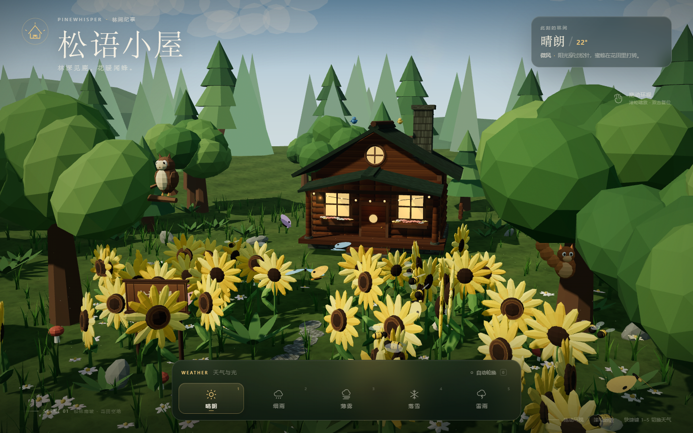
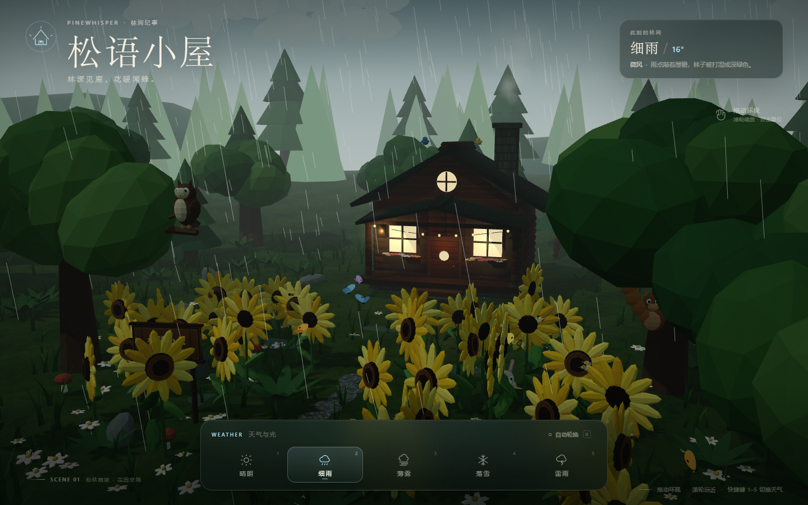
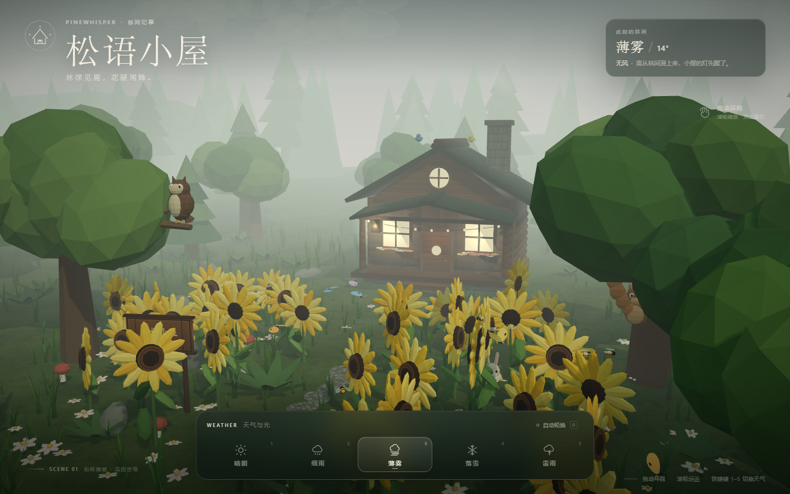
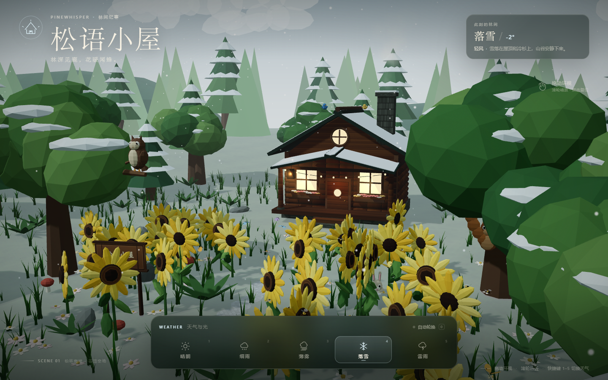
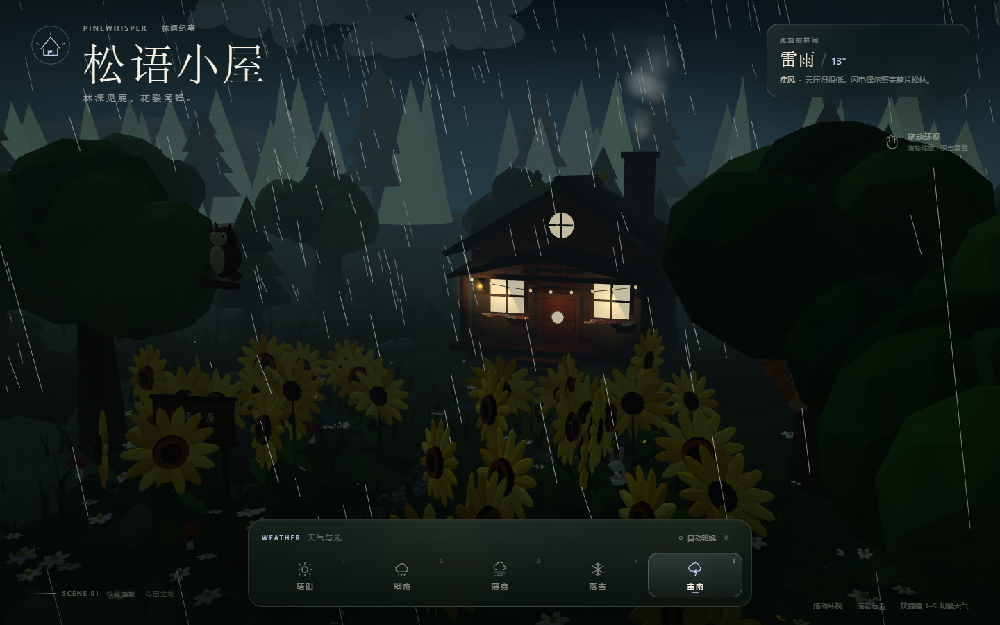
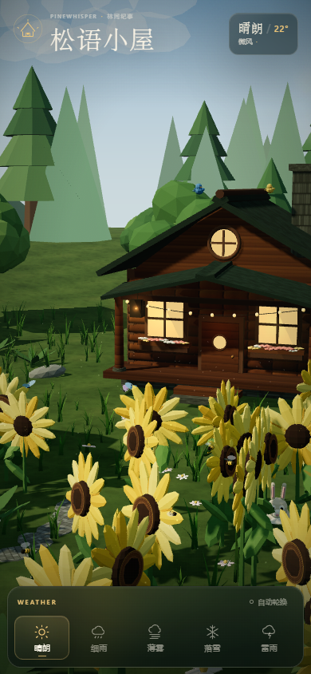

# 松语小屋 · Pinewhisper

一座藏在低多边形森林里的 Three.js 互动小屋。林间有松树、阔叶树、蘑菇与蕨类；树梢上住着猫头鹰和小松鼠，屋顶停着两只小鸟，花田里有兔子、蝴蝶和蜜蜂。小屋前的空地上种满了向日葵、野花和随风摆动的杂草。

可随时切换 **晴朗、细雨、薄雾、落雪、雷雨** 五种天气。天空、光照、雾密度、雨雪粒子、地面积雪、湿地面、窗灯与风强度都会平滑过渡。

**在线体验：** <https://dsh.zard.pro/>



## 运行

线上已部署，直接打开 <https://dsh.zard.pro/> 即可。本地运行不需要构建，也不依赖外网。Three.js 已放在 `vendor/` 中。

**方式一：双击**

```text
启动小屋.bat
```

**方式二：命令行**

```bash
node server.mjs
```

然后打开 <http://127.0.0.1:8765/>。

**方式三：Python**

```bash
python -m http.server 8765 --bind 127.0.0.1
```

> 请通过本地 HTTP 服务打开，不要直接双击 `index.html`。浏览器的模块安全策略会阻止 `file://` 下的 ES Module 加载。

## 操作

| 操作 | 效果 |
| --- | --- |
| 拖动画面 | 环绕观察小屋与花田 |
| 滚轮 / 双指捏合 | 拉近、拉远 |
| 双击画面 | 回到初始视角 |
| 点击底部天气按钮 | 切换天气 |
| `1` – `5` | 快速切换天气 |
| `0` | 开关自动轮换（每 26 秒） |
| `R` | 重置相机 |

## 场景内容

- **小木屋**：原木墙面、落雪屋顶、石砌烟囱、暖光窗户、门廊灯串、旧木招牌、柴堆与蘑菇。
- **森林**：多层冷杉、阔叶树、远景山脊与树线、蕨类、岩石、苔藓地面。
- **花田**：程序化生成向日葵（双环花瓣与种子纹理）、低矮草丛、白色小野花。
- **小动物**：树枝上的猫头鹰、树干上的松鼠、屋顶蓝鸟与黄鸟、草丛边的兔子。
- **昆虫**：7 只沿闭合曲线飞行的蝴蝶，10 只在花盘附近盘旋的蜜蜂。
- **天气**：
  - 晴朗：蓝天、暖阳、花粉与轻风。
  - 细雨：雨线、湿地反光、水洼、变暗的森林。
  - 薄雾：高密度体积雾感、柔和顶光、亮起的窗灯。
  - 落雪：飘雪、地面积雪、树冠与屋顶积雪。
  - 雷雨：低云、密集雨线、强风、随机闪电与屏幕闪光。
- **昼夜细节**：烟囱炊烟、窗灯、门廊灯串、水洼、风中摇动的向日葵与草丛。

## 目录

```text
.
├── index.html              页面、HUD 与天气面板
├── css/style.css           界面、加载页、响应式样式
├── js/main.js              渲染器、相机轨道、循环与 UI 交互
├── js/world.js             森林、小屋、花田、动物、昆虫与粒子
├── js/weather.js           天气配置、天空、光照、云雨雪与闪电
├── js/utils.js             可复现随机数、几何合并、程序化贴图
├── vendor/
│   └── three.module.min.js 本地 Three.js r160.1
├── screenshots/            五种天气与移动端预览
├── server.mjs              零依赖静态服务器
└── 启动小屋.bat            一键启动
```

## 自定义

- 天气参数集中在 `js/weather.js` 的 `CONFIGS` 中：天空颜色、雾密度、太阳强度、雨雪量、风、窗灯、雪盖和昆虫活跃度都可以单独调整。
- 每 26 秒自动轮换可在 `js/main.js` 中修改 `autoElapsed > 26`。
- 所有模型和贴图均由代码生成，没有外部图片素材；向日葵、树木与草丛数量可在 `js/world.js` 中调整。

## 预览

| 细雨 | 薄雾 | 落雪 | 雷雨 |
| --- | --- | --- | --- |
|  |  |  |  |

<p align="center"></p>
